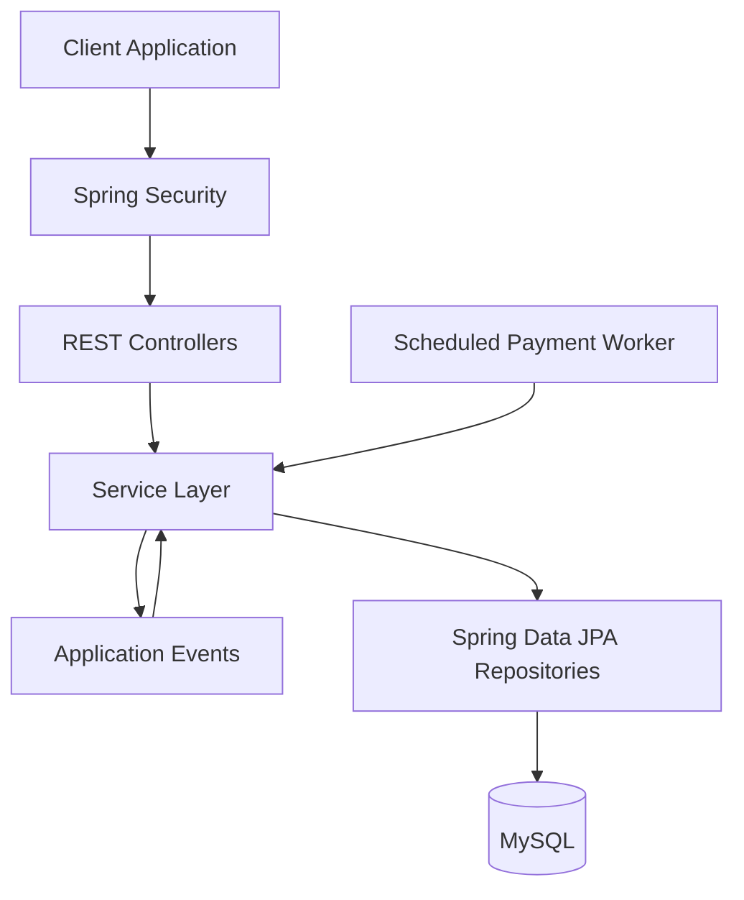

# PayFlow — Smart Wallet & Scheduled Payment System

PayFlow is a **Spring Boot-based smart wallet application** designed to manage wallet balances, process financial transactions, maintain transaction history, and schedule payments for future execution.

The project focuses on backend engineering concepts such as secure authentication, transaction consistency, idempotent requests, asynchronous processing, and scheduled job execution.

## Features

- **Wallet Management** — Retrieve wallet balances and perform wallet operations.
- **Add Money** — Initiate wallet top-ups with transaction status tracking.
- **Wallet Transfers** — Transfer funds between users' wallets.
- **Idempotency** — Use idempotency keys to help prevent duplicate processing of repeated requests.
- **Transaction History** — Retrieve transaction records with pagination and optional date filters.
- **Scheduled Payments** — Schedule payments for future execution and cancel eligible scheduled payments.
- **Automated Execution** — Use scheduled background processing to identify and execute payments when they become due.
- **Retry Handling** — Track failed scheduled payment attempts and apply retry limits.
- **Authentication & Authorization** — Protect user endpoints using Spring Security, JWT-based authentication, and OAuth2 login.
- **Asynchronous Processing** — Use Spring application events and asynchronous listeners for payment-processing workflows.
- **Database Consistency** — Use database transactions and optimistic locking where implemented to help maintain consistent financial state.

## Technology Stack

| Category | Technologies |
|---|---|
| Language | Java |
| Backend Framework | Spring Boot |
| Security | Spring Security, JWT, OAuth2 |
| Database | MySQL |
| Persistence | Spring Data JPA / Hibernate |
| Background Processing | Spring Scheduling |
| Asynchronous Processing | Spring Events, `@Async` |
| Build Tool | Maven |
| API Testing | Postman |
| Version Control | Git, GitHub |

## Architecture Overview

PayFlow follows a layered backend architecture that separates HTTP request handling, business logic, data access, and background processing.



The diagram represents the main architectural responsibilities. Exact call paths and transaction boundaries depend on each workflow's implementation.

## Core Modules

### 1. Wallet Management

The wallet module provides operations for retrieving balances and initiating wallet transactions. Authenticated user information is used to identify the wallet associated with the request.

### 2. Money Addition

The add-money workflow creates a transaction and initiates its processing. Idempotency keys are used to identify repeated requests, while transaction status indicates the outcome of processing.

### 3. Wallet Transfers

The transfer workflow identifies the sender and receiver, accesses their wallets, and delegates the operation to the wallet service. Financial updates must remain consistent if a transfer fails or concurrent requests occur.

### 4. Scheduled Payments

Users can schedule payments by specifying a recipient, amount, message, and scheduled execution time. Eligible payments can later be picked up by a background worker.

The scheduled-payment workflow includes payment status tracking, retry-count tracking, and cancellation support.

### 5. Transaction History

The transaction-history module provides paginated transaction records and scheduled-payment history. Optional date filters help users narrow their results.

### 6. Security

The application uses Spring Security to protect user endpoints. JWT authentication is supported through a cookie-based login flow, and OAuth2 login is configured through Spring Security.

## API Overview

The following endpoints are based on the controllers currently reviewed. Request and response schemas should be documented alongside the final API implementation.

| Method | Endpoint | Purpose |
|---|---|---|
| POST | `/api/v1/public/login` | Authenticate a user |
| POST | `/api/v1/public/logout` | Log out a user |
| POST | `/api/v1/public/register` | Register a user and initialize a wallet |
| GET | `/api/v1/public/me` | Retrieve the current user's profile |
| GET | `/api/v1/user/wallet/balance` | Retrieve wallet balance |
| POST | `/api/v1/user/wallet/add-money` | Initiate a wallet top-up |
| POST | `/api/v1/user/wallet/transfer` | Initiate a wallet transfer |
| POST | `/api/v1/user/schedule-payment` | Create a scheduled payment |
| DELETE | `/api/v1/user/schedule-payment/{id}` | Cancel a scheduled payment |
| GET | `/api/v1/user/transactions` | Retrieve transaction history |
| GET | `/api/v1/user/transactions/{id}` | Retrieve a transaction by ID |
| GET | `/api/v1/user/transactions/scheduled-payments` | Retrieve scheduled-payment history |

**Security note:** The transaction-by-ID endpoint should verify that the requested transaction belongs to the authenticated user before returning its details.

## Getting Started

### Prerequisites

Install the following before running the application:

- Java version compatible with the project's Spring Boot configuration
- Maven
- MySQL
- Git

### 1. Clone the repository

```bash
git clone <your-repository-url>
cd PayFlow
```

Replace `<your-repository-url>` with your GitHub repository URL.

### 2. Configure the database

Create a MySQL database for PayFlow, then configure the database connection using your application's configuration file or environment variables.

Example environment variables:

```properties
SPRING_DATASOURCE_URL=jdbc:mysql://localhost:3306/payflow
SPRING_DATASOURCE_USERNAME=${DB_USERNAME}
SPRING_DATASOURCE_PASSWORD=${DB_PASSWORD}
```

Adapt these settings to the configuration keys used by your application. Keep database credentials and other secrets out of version control.

### 3. Configure authentication

Provide the required JWT signing configuration, OAuth2 client settings, and other credentials used by your application.

Store secrets in environment variables or a secure configuration mechanism rather than committing them to GitHub.

### 4. Build the application

```bash
./mvnw clean package
```

On Windows, use:

```bash
mvnw.cmd clean package
```

If the project does not include the Maven Wrapper, use an installed Maven distribution.

### 5. Run the application

```bash
./mvnw spring-boot:run
```

The application will start using the active Spring configuration. Verify the configured port and database connection before testing the APIs.

## Testing

Use Postman or another HTTP client to test the REST endpoints.

Recommended scenarios include:

- Register a user and verify wallet initialization.
- Log in and access protected endpoints.
- Add money and inspect the resulting transaction status.
- Submit repeated requests with the same idempotency key.
- Transfer funds between two users.
- Schedule a payment and verify its execution eligibility.
- Cancel a scheduled payment and verify its status.
- Retrieve transaction history using pagination and date filters.
- Test insufficient balances and invalid request data.
- Test concurrent requests and confirm that financial records remain consistent.

## Engineering Considerations

PayFlow explores several important backend design concerns:

- **Idempotency:** Repeated requests should not result in duplicate financial operations.
- **Transaction Management:** Related wallet and transaction updates must be committed or rolled back consistently.
- **Concurrency:** Concurrent wallet updates require appropriate locking or optimistic concurrency controls.
- **Retry Safety:** Retried scheduled payments must not execute the same financial operation twice.
- **Authorization:** Users should only be able to access transactions and scheduled payments they are authorized to view or modify.
- **Asynchronous Processing:** Event-driven work should have clear transaction boundaries and reliable failure handling.

These properties should be verified through implementation and testing rather than assumed from annotations alone.

## Future Improvements

Potential next steps include:

- Add automated unit and integration tests using JUnit and Mockito.
- Document request and response schemas using OpenAPI / Swagger.
- Add structured logging and application health monitoring.
- Introduce durable event delivery, such as an outbox pattern, where stronger processing guarantees are required.
- Add database constraints and concurrency tests for idempotency and payment execution.
- Add Docker-based local development and deployment configuration.

## Project Status

PayFlow is an ongoing backend engineering project. The README describes the modules and workflows reviewed so far; implementation details and guarantees should be updated as additional classes, tests, and configurations are verified.

